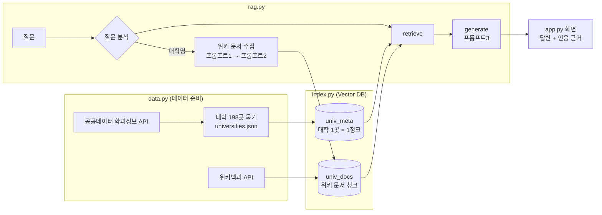

# RAG 파이프라인 설계문서 — UniGuide

## 1. 전체 구조



| 모듈 | 책임 |
|---|---|
| `config.py` | 키(.env), 모델, 경로, 청크 크기·중복·Top-k |
| `data.py` | 공공데이터 수집·정리, 대학 텍스트 구성, 위키백과 API, 질문 속 대학명·지역·학과·학교명 조건 찾기, 도메인 문구 |
| `index.py` | Chroma 컬렉션 생성·조회, 메타데이터 색인, 위키 문서 청킹·색인, 검색 함수 |
| `rag.py` | 프롬프트, 문서 수집 파이프라인, LangGraph(retrieve → generate), 대학 비교 |
| `app.py` | Streamlit 화면 |

사용 모델(SSAFY GMS 경유): 검색어 추출·후보 선별 `gpt-4.1-mini`, 답변 생성·학과명 판단·대학 비교 `gpt-5.4-mini`, 임베딩 `text-embedding-3-small`.

## 2. Vector DB 컬렉션 구조와 메타데이터 필드

Chroma(PersistentClient, `chroma_db/`), 거리 함수는 코사인.

### 2.1 `univ_meta` — 대학 메타데이터 (RAG 1)

| 항목 | 내용 |
|---|---|
| 청크 단위 | 대학 1곳 = 1청크 (198건). 쪼개지 않는다 |
| 청크 ID | 대학명 (예: `경상국립대학교`) → 다시 색인하면 덮어쓰기(upsert)만 일어난다 |
| 본문 | 대학명(학교 구분) / 소재지 / 학과 수·입학정원 합계 / 계열 구성 / 학과(입학정원) 목록 / 관련 직업 |
| 메타데이터 | `item_id`(대학명), `title`("OO대학교 학과 공시 정보 (2025)"), `url`(공공데이터포털 페이지), `source_type`=`meta`, `region`(대표 시·도) |

본문 예시:

```
대학명: 경상국립대학교 (대학교)
소재지: 경상남도 진주시, 경상남도 통영시, 경상남도 창원시
학사과정 학과 140개, 입학정원 합계 4261명 (2025년 공시)
계열: 공학계열 49개, 인문ㆍ사회계열 45개, 자연과학계열 37개, 예ㆍ체능계열 6개, 의학계열 3개
학과(입학정원): AI정보공학과 30, …, 경영정보학과 38, 경영학부 97, …
관련 직업: …
```

### 2.2 `univ_docs` — 위키 문서 청크 (RAG 2)

| 항목 | 내용 |
|---|---|
| 청크 단위 | 위키 문서 본문을 1,000자 / 200자 중복으로 분할 (현재 37개 문서, 502청크) |
| 청크 ID | `대학ID:문서ID:순번` (예: `연세대학교:12345:3`) → 여러 대학이 같은 문서를 수집해도 서로 덮어쓰지 않는다 |
| 메타데이터 | `item_id`(관련 대학), `doc_id`(위키 pageid), `title`(문서 제목), `url`(원문 URL), `source_type`=`wikipedia`, `query`(수집한 검색어) |

`item_id`는 검색 범위를 질문한 대학으로 좁히는 필터다. 이 값이 없으면 다른 대학의 문서가 근거에 섞인다(예: "고려대 캠퍼스는 어디야?"에 의미가 비슷한 연세대 캠퍼스 청크가 검색됨).

### 2.3 컬렉션을 둘로 나눈 이유

- 메타데이터는 **항상 포함**하는 근거이고, 위키 문서는 **질문과의 유사도로 골라야** 하는 근거다. 검색 방식이 달라서 컬렉션을 나눴다.
- 대학 수(198)와 메타 청크 수(198)가 항상 같아야 검증할 수 있다. 위키 청크가 섞이면 이 대조가 불가능하다.

## 3. 문서 수집·청킹·색인 흐름

### 3.1 항목 메타데이터 (최초 1회: `python data.py` → `python index.py`)

1. `fetch_majors()`: 학교명 `대학교`로 전체를 받아 4년제(대학교·교육대학·산업대학) 학교 이름 208개를 모은다.
2. 학교 이름마다 다시 조회(한 번에 최대 10,000행)하고, 완전히 같은 행은 하나만 남긴다 → 원본 48,086행 (`data/raw/` 캐시).
3. `build_items()`: 학사과정만 남기고, '폐과'라도 2025년 정원이 있으면 포함한다. 주간·야간으로 나뉜 같은 학과는 합친다. 정원과 졸업자가 모두 0명인 학교(폐교·통합 전 교명)는 뺀다 → 198곳.
4. 소재지는 학과 소재지 기준으로 모두 기록하고, 학과가 가장 많은 캠퍼스의 시·도를 대표 지역(`region`)으로 둔다.
5. `index.py`: `item_text()`로 만든 텍스트를 50건씩 임베딩해 `univ_meta`에 upsert한다.

### 3.2 위키 문서 (질문에 대학명이 있을 때 자동 수집)

```mermaid
flowchart TD
    S[질문 + 대학] --> Q0{같은 대학·같은 질문<br/>수집 기록 있음?}
    Q0 -->|예| END1[수집 생략]
    Q0 -->|아니오| O{대학 자체 문서<br/>수집했나?}
    O -->|아니오| O1[제목 일치 문서 찾기<br/>'건국대학교(글로컬)' → '건국대학교 글로컬캠퍼스']
    O1 --> O2[선별·길이 규칙 없이 항상 색인]
    O -->|예| P1
    O2 --> P1[프롬프트1: 검색어 최대 3개]
    P1 --> L{검색어마다<br/>이미 수집?}
    L -->|예| SKIP[건너뜀]
    L -->|아니오| WS[위키 검색 후보 5개<br/>제목·요약만]
    WS --> P2[프롬프트2: 최대 2개 선별]
    P2 --> F[선별 문서만 본문 수집<br/>300자 미만 제외]
    F --> CH[1,000자/200자 청킹]
    CH --> IX[univ_docs 색인<br/>같은 대학·문서의 옛 청크는 삭제 후 저장]
```

- 본문을 받기 전에 제목·요약으로 먼저 거르기 때문에, 외부 호출 수와 색인되는 무관한 문서가 줄어든다(예: '김택진', '고려대학교–연세대학교 정기전' 같은 후보는 제외).
- 수집 기록(`data/collect_log.json`): `{대학: {검색어: [문서ID]}}` + `_questions: {"대학|질문": [검색어]}`. 문서 원문은 `data/docs/{문서ID}.json`에 한 번만 저장해 여러 대학이 함께 쓴다.

## 4. 검색 결과의 병합과 중복 제거

질문을 먼저 분석해(`data.names_in` / `filter_items` / `regions_in`) retrieve 노드가 근거를 고르는 방식을 정한다.

| 질문 유형 | 판단 기준 | 근거로 쓰는 것 |
|---|---|---|
| 특정 대학 | 질문에 대학명·줄임말(연세대) / 사이드바에서 대학 선택 | `univ_meta`의 그 대학 청크(항상) + `univ_docs`에서 `item_id` 필터 Top-k 유사도 검색 |
| 학과·학교명 조건 | 학과 키워드(간호학과, 해양 관련), 여러 대학 이름에 공통으로 들어간 말(여자대학교) | 198개 대학을 코드로 직접 거른 결과 (지역명이 있으면 함께 적용) |
| 지역 | 서울·부산·경남 등 | `univ_meta`에서 `region` 필터로 그 지역 대학 전체 |
| 그 밖 | — | `univ_meta` 의미 검색 상위 15곳 |

병합·중복 제거(`rag.make_evidence`):

1. 메타데이터 청크를 먼저, 위키 청크를 뒤에 이어 붙인다 (메타 근거가 항상 [근거 1]).
2. 청크 ID가 같으면 한 번만 남긴다. ID 규칙이 `대학ID:문서ID:순번`이라, 같은 청크가 두 번 검색돼도 하나만 남는다.
3. 남은 근거에 1부터 번호를 붙이고 출처 유형(`대학 학과 공시` / `위키백과`)을 붙인다.

## 5. 프롬프트 설계

모든 프롬프트는 같은 역할 문장으로 시작한다: *"너는 국내 대학과 학과 정보에 밝은 진학 상담 전문가야."*

| 프롬프트 | 역할 | 입력 | 출력 형식 |
|---|---|---|---|
| **1. 검색어 추출** `QUERY_PROMPT` | 질문에 답할 위키 문서를 찾을 검색어를 만든다. 대학 이름을 넣은 짧은 명사구로 쓴다 | 대학명, 질문 | JSON 문자열 배열 (최대 3개) 예: `["연세대학교 역사", "연세대학교 설립"]` |
| **2. 후보 선별** `SELECT_PROMPT` | 검색 후보 중 그 대학과 직접 관련된 문서만 고른다. 다른 대학·동음이의·인물 문서는 버린다 | 대학명, 질문, 후보 제목·요약 목록 | JSON 정수 배열 (최대 2개) 예: `[1, 3]` |
| **3. 답변 생성** `ANSWER_PROMPT` | 번호 붙은 근거만으로 답한다. 근거에 없으면 "제공된 문서에서 확인되지 않습니다". 확인되지 않는 문장에는 근거 번호를 붙이지 않는다 | 근거 목록, 최근 대화 4개(근거 번호 제거), 질문 | 문장 끝에 `[근거 n]`을 붙인 한국어 답변 |

보조 프롬프트:

| 프롬프트 | 역할 | 출력 |
|---|---|---|
| `MAJOR_PROMPT` (학과명 판단) | 키워드가 단어 중간에 들어간 학과명(바이오의약학과, 정보컴퓨터공학부)이 찾는 학과와 같은 전공인지 판단 | 다른 전공인 번호의 JSON 정수 배열 |
| `COMPARE_PROMPT` (대학 비교) | 두 대학의 비교표와 차이점 | 비교표(마크다운) + 차이점, 모든 사실에 `[근거 n]` |

파싱 가능한 형식(JSON 배열)을 쓰는 프롬프트는 응답에서 첫 `[...]`만 꺼내 읽고, 실패하면 빈 배열로 처리한다(`parse_json_list`). 그래서 코드블록이나 설명이 섞여도 동작한다.

## 6. 청크 크기·중복 길이·Top-k

| 설정 | 값 | 이유 |
|---|---|---|
| `CHUNK_SIZE` | 1,000자 | 대학 위키 문서는 평균 약 7,000자(최대 26,000자)이고, 연혁의 한 시기나 캠퍼스 하나가 보통 한 문단(수백~1,000자)이다. 1,000자면 한 주제가 한 청크에 들어간다 |
| `CHUNK_OVERLAP` | 200자 (20%) | 청크 경계에서 문장이 잘려 "1957년에 … 통합"처럼 사실이 둘로 나뉘는 것을 막는다 |
| `TOP_K` | 5 | 메타 1개 + 위키 5개 = 근거 6개. 캠퍼스가 3곳인 대학도 모두 담을 수 있고, 프롬프트가 지나치게 길어지지 않는다 |
| `META_K` | 15 | 조건이 없는 질문의 의미 검색 대학 수 |
| 메타 청크 | 분할하지 않음 | 대학명과 학과 목록이 떨어지면 "OO대 간호학과 정원" 질문에서 대학을 특정할 수 없다. 가장 긴 대학도 임베딩 한도 안이다 |

### 값을 바꿨을 때의 차이 (실측)

| 변경 | 결과 |
|---|---|
| 청크 1,000/200 → 500/100 | 위키 청크 502건 → **1,031건** (약 2배). 같은 Top-k에서 근거 한 개가 담는 내용이 절반이 되어, 연혁·캠퍼스처럼 여러 문단에 걸친 답이 잘린다 |
| Top-k 2 | "연세대 캠퍼스는 어디에 있어?" 근거 3개(메타 + 신촌캠퍼스 + 미래캠퍼스) → **국제캠퍼스(송도)가 근거에 없음** |
| Top-k 5 (기본) | 신촌·미래·국제 캠퍼스 문서가 모두 근거에 들어가 세 캠퍼스를 모두 답함 |
| Top-k 8 | 근거 9개. 같은 문서의 청크가 반복되고(신촌캠퍼스 3개, 국제캠퍼스 2개) 새 정보는 늘지 않음 → 프롬프트만 길어짐 |

청크 값은 `.env`에서 바꾸고 `python index.py --docs`로 받아 둔 문서를 다시 청킹한다(외부 호출 없음). Top-k는 사이드바 슬라이더로 바로 바꿀 수 있다.

## 7. 답변에 근거를 표시하는 방식

1. generate 노드가 근거를 `[근거 n] (출처 유형) 제목\n본문` 형식으로 프롬프트에 넣는다.
2. 프롬프트 3이 주요 주장 문장 끝에 `[근거 1]`, `[근거 2, 3]`처럼 번호를 붙인다.
3. `cited()`가 정규식 `\[근거\s*([\d,\s]+)\]`로 본문에 실제로 나온 번호만 모은다.
4. 화면(📎 근거 n건)에는 **인용된 근거만** `[근거 n] 출처유형 제목(원문 링크)` 형식으로 보여준다. 검색됐지만 인용되지 않은 근거는 보여주지 않는다.
5. 인용된 근거가 하나도 없으면 "이 답변에는 인용된 근거가 없습니다."를 표시한다.
6. 목록형 질문(학과·학교명 조건)은 코드가 대학마다 `[근거 n]`을 붙여 목록을 만들고, 목록의 모든 대학이 근거로 표시된다.
7. 다음 질문의 대화 기록에서는 이전 답변의 근거 번호를 지운다. 번호가 매 질문마다 다시 매겨지기 때문이다.

## 8. 도메인 특화 기능 — 대학 비교

- **무엇을**: 두 대학과 관심 분야(선택)를 고르면 비교표(소재지, 입학정원 합계, 학과 수, 계열 구성, 관심 분야 관련 학과)와 차이점 3~5개를 만든다.
- **어떤 근거로**: 두 대학의 `univ_meta` 청크 + 두 대학 범위의 위키 청크(관심 분야로 검색, 4개). 비교 대상의 대학 자체 문서가 없으면 먼저 수집한다.
- **왜 이 기능인가**: 진학 탐색에서 가장 흔한 행동은 후보 2~3곳을 놓고 비교하는 것이다. 그런데 비교는 수치를 틀리기 쉽고, 평판·순위 같은 근거 없는 내용으로 채워지기 쉽다. 그래서 공시 수치만 쓰고, 근거에 없는 항목(순위, 평판 등)은 "확인되지 않습니다"로 쓰게 했다.
- **비용**: 비교에는 대학 자체 문서만 수집한다(검색어 추출 생략). 처음 비교하는 대학 쌍은 약 20~30초, 같은 쌍을 다시 비교하면 약 6초.

## 9. 설계 선택의 이유와 겪은 문제·해결 과정

### 9.1 선택의 이유

- **항목 = 대학**: 학과 단위(1만 개)로 하면 학과마다 위키 문서가 거의 없다. 대학 단위는 위키 문서가 충실하고, 학과 정보는 대학 텍스트 안에 넣었다.
- **질문 유형별 retrieve**: "서울 소재 대학"처럼 전체 대학을 대상으로 하는 질문은 의미 검색 Top-k로는 일부만 나온다. 그래서 지역·학과·학교명이 드러나면 메타데이터로 직접 거르고, 의미 검색은 그 밖의 질문에만 쓴다.
- **프롬프트 2를 따로 둔 이유**: 위키 검색 결과에는 대학 이름이 본문에 나오는 인물·다른 대학 문서가 많다. 본문을 받기 전에 제목·요약으로 버리면 외부 호출과 잡음이 함께 준다.

### 9.2 겪은 문제와 해결

| # | 문제 | 원인 | 해결 |
|---|---|---|---|
| 1 | GMS 호출 404 | base URL을 `gms.p.ssafy.io`로 사용 | `https://gms.ssafy.io/gmsapi/api.openai.com/v1`로 수정 |
| 2 | 경상국립대 경영정보학과 등 실제 학과가 누락 | 6만 행을 1,000행씩 받는 동안 API의 정렬 순서가 바뀌어 **2,314행 중복, 같은 수만큼 누락** | 학교 이름별로 다시 조회(한 번에 최대 10,000행)하고 같은 행 제거 → 학과 9,992개 → 10,615개 |
| 3 | 호서대·부산교대·금강대가 통째로 빠짐 | '폐과' 표시 행만 정원을 갖거나(호서대), 정원이 0으로 공시됨(부산교대) | '폐과'라도 정원이 있으면 포함, 정원·졸업자가 모두 0인 학교만 제외 → 195곳 → 198곳 |
| 4 | 경희대 소재지가 '경기도'로만 표시 | 첫 행의 지역만 사용 | 학과 소재지 전체를 기록하고 학과가 가장 많은 곳을 대표 지역으로 사용 |
| 5 | "간호학과와 약학과가 모두 있는 대학" 결과가 정답 30여 곳 중 일부만 나옴 | 의미 검색 상위 15곳에서만 찾음 | 학과 키워드로 198개 대학을 코드로 직접 거름 |
| 6 | "서울 소재 대학"이 이름에 '서울'이 들어간 7곳만, 부산 해양 질문에서 국립부경대 누락 | 지역명·학과 키워드가 학교명 조건으로 잘못 잡힘 | 학교명 조건에서 지역명과 학과 키워드를 제외 |
| 7 | "컴퓨터공학과"로 물으면 고려대 '컴퓨터학과'가 안 나옴 | 키워드가 `컴퓨터공` | 키워드 끝의 '공'을 떼고 `컴퓨터`로 비교 → 서울 13곳 → 24곳 |
| 8 | 같은 목록형 질문의 결과가 실행마다 달라짐(17~38곳) | LLM이 30곳 가까운 목록을 직접 쓰면서 일부를 빼먹고, 대학 단위로 판단하면 기준이 흔들림 | ① 판단 단위를 대학 → **학과명**으로 바꿈 ② 이름이 키워드로 시작하면(약학과, 약학부) 바로 인정하고 단어 중간에 들어간 이름(바이오의약학과)만 LLM이 판단 ③ '계약학과·협약학과'는 운영 형태 표기라 비교에서 제거 ④ 목록은 코드로 작성 → **4회 반복 모두 정답 29곳과 일치** |
| 9 | 교수 인물 문서('장병탁')가 근거로 선별됨 | 프롬프트 2가 "그 대학 출신 인물"만 제외 | "출신이나 교수 같은 인물 문서는 버린다"로 규칙 보완 |
| 10 | 답변 모델을 바꾼 뒤 "확인되지 않습니다"에도 근거 6개를 붙임 | 근거 번호 규칙을 글자 그대로 적용 | "확인되지 않는다는 문장에는 근거 번호를 붙이지 않는다" 추가 |
| 11 | 같은 질문을 다시 해도 "재수집 안 함" 안내가 안 보임 | 답변 후 화면을 다시 그리며 진행 상태 박스가 사라짐 | 수집 내역을 메시지에 저장해 답변 아래 표시, (대학, 질문) 단위 캐시 추가 → 재질문 14초 → 1.7초 |
| 12 | "국립대"를 구분할 수 없음 | 공시 데이터에 설립 유형 필드가 없음 | 화면에 '구분할 수 없는 조건'을 안내하고 해당 단어가 있으면 경고 표시 (개선안: 대학알리미 설립구분 데이터 추가) |
