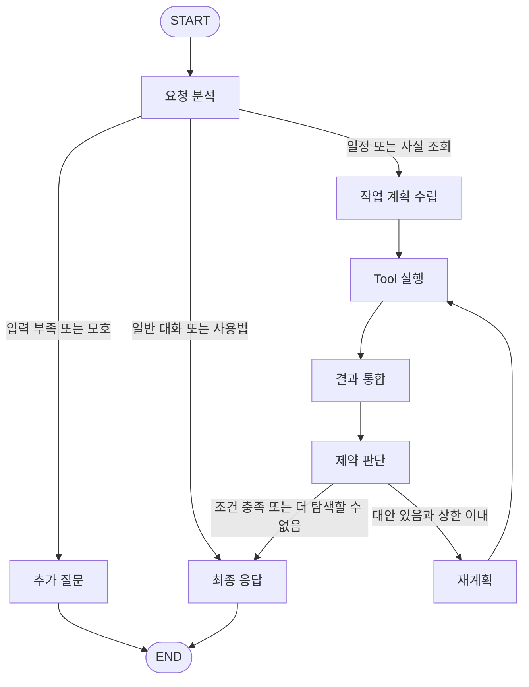

# LangGraph 실행과 로깅 설계

아래 구조는 공식 명세서 §2.4~2.5, F3005~F3014를 바탕으로 설계했다. [LangGraph](../backend/agents/graph.py), [GMS 요청 분석](../backend/agents/analyze.py), [로깅 구독자](../backend/agents/logger.py)에 구현했다. 추가 질문은 실행 그래프에서 최종 응답 노드의 조건 분기로 처리한다.

## AgentState

| 필드 | 형식과 의미 |
| --- | --- |
| `session_id`, `run_id` | UUID. 대화 세션과 한 턴 실행 식별 |
| `message`, `prior_summary` | 이번 요청과 직전 답변 요약 |
| `intent`, `intent_reason` | `create_plan\|revise_plan\|lookup\|help\|other`와 한 줄 분류 근거 |
| `conditions`, `missing_fields` | 기준 `date, start_time, end_time`, 선호 `region, category, weather`, 제약 `count, max_rain_pct, budget, min_stay_minutes, max_leg_minutes` 및 누락 항목. 값은 추출 근거와 함께 보관 |
| `tasks` | `{task_id, tool, arguments, input_from, dependencies, required}` 목록 |
| `tool_results`, `attempted_keys` | 도구명과 정규화된 인자 키로 결과 저장. 같은 검색 범위 반복 방지 |
| `candidates`, `excluded`, `warnings` | 통합 후보, 근거 있는 제외 사유, 제약 미확인 또는 Tool 실패 |
| `constraint_results` | 제약 단위 `met\|not_met\|unknown`, 계산값, 조건 기준, 근거 및 사유 |
| `replan_count`, `max_replans`, `stop_reason` | 최초 계획은 0. 재계획 최대 3회와 종료 사유 |
| `draft_plan`, `response`, `events` | 임시 일정, 최종 응답, 이번 실행의 화면용 이벤트 |

## 노드 계약

| 노드 | 입력 | 출력 및 다음 조건 |
| --- | --- | --- |
| 요청 분석 | 메시지, 세션 요약 | 의도·조건·누락 항목. 일정 요청의 위치·날짜·시간대·장소 수가 부족하면 질문, 일반 대화는 응답, 나머지는 계획 |
| 추가 질문 | 누락·모호 항목 | 한 번에 필요한 값을 요청. B 같은 조건부 사실/후보 조회는 날짜·지역으로 가능하며, 시간대 확정이 필요한 일정 요청에서 추가 질문 |
| 작업 계획 | 의도·조건, 등록 Tool 설명, TourAPI 지역 코드 목록 | 시도·시군구 코드로 후보를 조회한다. 반환된 ID는 상세 조회로, 확인된 장소 좌표와 방문일은 날씨 조회로 넘긴다. 대기질은 목적지 시도의 현재 관측값을 확인한다. |
| Tool 실행 | 작업 목록 및 기존 결과 | 등록 인자 검증 후 실행. 결과 또는 안전한 오류를 작업별로 저장. 실패한 작업에 의존한 후속 작업은 사유를 남기고 건너뛰며 독립 작업은 계속 |
| 결과 통합 | Tool 결과 | ID 기준 후보와 상세 결합, 관측/예보를 구별해 보관 |
| 제약 판단 | 후보, 조건, 보조 데이터 | 조건별 값과 근거를 산출. 충족, 부분 제안, 재계획 중 경로 결정 |
| 재계획 | 제외 사유, 시도 이력 | 다른 페이지·유형 검색 등 새로운 작업을 만들고 실행 직전에 카운터를 1 증가. 사용자가 고정한 날짜·지역·기타 제약은 유지 |
| 최종 응답 | 후보, 판단, 종료 이유 | 추천·제외 사유·Tool 결과 근거·예보/관측·미확인 값과 필요 확인 질문. 구성한 초안과 세션 요약 갱신 |

## 제약 판단과 재계획

- 날짜/시각은 KST로 계산한다. 방문 창은 `end_minutes - start_minutes`다. `필요시간 = Σ 확인된 체류시간 + Σ 확인된 이동시간`의 전체 항이 있을 때만 `필요시간 ≤ 방문 창`과 운영시간을 확인한다. 사용자가 지정한 최소 체류시간으로 얻은 하한이 창을 초과하면 불충족이다. 이동시간이 없으면 `이동 예산 = 방문 창 - Σ 확인된/사용자 지정 체류시간`을 제시한다. 체류시간도 없으면 `(체류시간 + 이동시간) 합계 ≤ 방문 창`까지만 제시한다. 좌표 거리는 순서 참고의 직선거리로만 쓰고, 이동시간으로 바꾸지 않는다.
- 고유 적합 후보 수가 요청 수 이상이어야 한다. 가격 상한은 허용 비용의 모든 항이 확인될 때 비교한다. 가격 미확인은 0원으로 간주하지 않는다.
- “비가 오면 실내”는 일별 최대 강수 확률이 사용자 기준 또는 기본 50% 이상이면 발동한다. 이 50%는 프로젝트 정책이다. 실내 근거가 부족하면 해당 제약을 미확인으로 둔다. 에어코리아 관측값은 방문일 예보 조건에서 항상 제외한다.
- 대체 후보를 찾으면 결과가 달라질 수 있고 미시도 작업이 있을 때만 재계획한다. 가능한 후보가 부족하거나, 강수 기준으로 야외 후보를 교체해야 하는 경우다. 충족, 추가 질문 필요, 키·권한·쿼터 오류, 대체해도 해결할 수 없는 예보 범위/결측, 더 탐색할 범위 없음은 종료 조건이다. 날씨 오류가 관광지 제안까지 막지 않으면 부분 결과를 보낸다.
- 실행 내 캐시 키는 Tool 이름과 기본값을 채운 정규화 인자의 조합이다. 성공 결과와 같은 범위의 빈 결과를 재사용하고, 상세는 같은 ID를 다시 부르지 않는다. 3회 실행 후 결과를 판단하고 조건 미충족이면 상한 및 구체적 사유를 응답한다.

## 세션 Memory

세션별 직전 요청의 구조화 조건, 응답 요약, 후보 ID, 보류 중인 질문과 초안의 참조를 유지한다. 후속 요청의 명시 변경만 덮어쓰고 명시 초기화나 새 대화에서는 이전 조건을 비운다. 원본 API 응답과 키를 저장하지 않는다. 새 턴의 날씨·대기질은 필요한 때 다시 조회한다. 같은 세션의 실행을 직렬화해 조건 덮어쓰기를 방지하고 다른 세션은 분리한다.

## 실행 이벤트

이벤트 공통 필드는 `event_id:uuid, session_id:uuid, run_id:uuid, seq:int, type:string, node:string, occurred_at:datetime, payload:object`다. `seq`는 실행 내 단조 증가한다.

| 종류 | payload |
| --- | --- |
| `node_enter`, `node_exit` | 상태 요약, 성공 여부, 처리 시간 |
| `tool_requested` | Tool 이름, task ID, 검증·정제한 인자, 캐시 사용 여부 |
| `tool_completed` | task ID, 성공 여부, 결과 필드·개수 또는 오류 코드, `duration_ms` |
| `llm_decision`, `conditions_extracted` | 선택된 의도, 공개 가능한 근거 한 줄과 파싱된 조건 |
| `replanned` | 횟수, 원인, 추가 작업과 재사용 항목 |
| `run_finished` | 종료 코드, 총 처리 시간, 재계획 횟수 |

메인 Agent는 이벤트 버스에 발행하고, 화면에 반환할 실행 요약은 실행 상태에서 만든다. 별도 로깅 Agent는 버스를 구독해 이벤트를 세션과 실행 순서로 SQLite에 추가한다. 수집·저장에 LLM을 사용하지 않는다. 발행 전에 키, 인증 정보, 원본 오류를 제외하며, 저장 시 발행된 이벤트를 그대로 보존한다. 구독자 없음·저장 실패가 대화에 전파되지 않도록 이벤트 전달 실패를 격리한다. 로그 API는 목록·상세·삭제를 제공한다.
