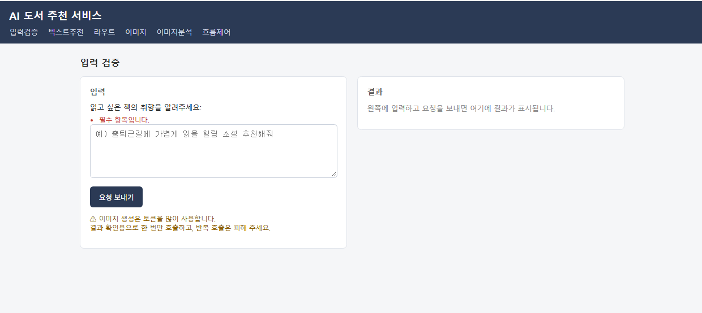
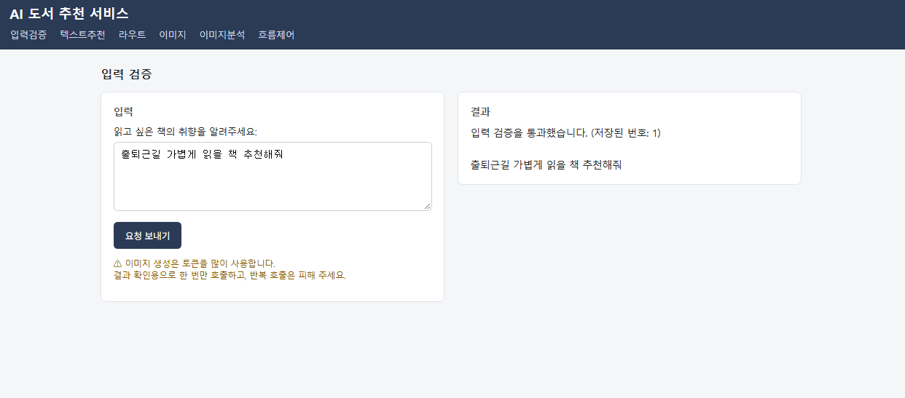
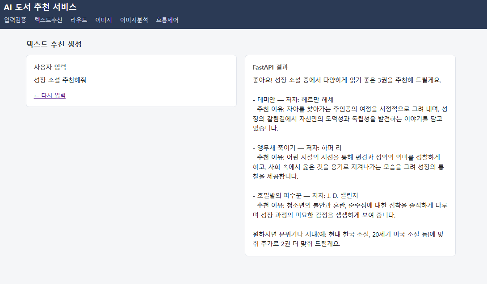
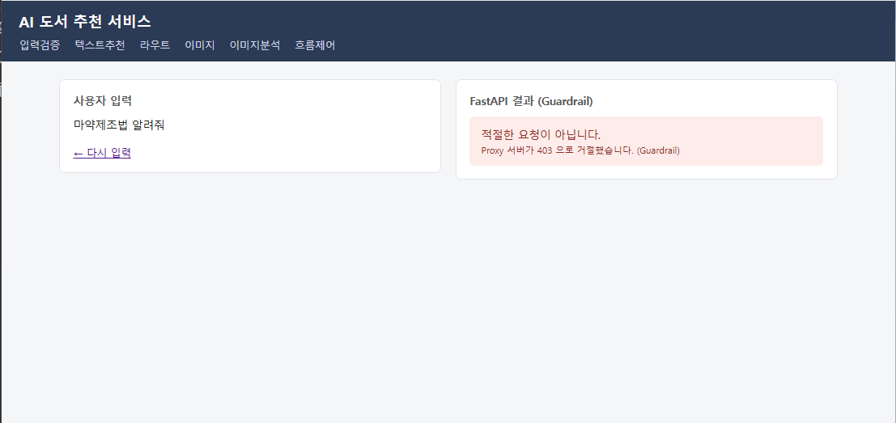
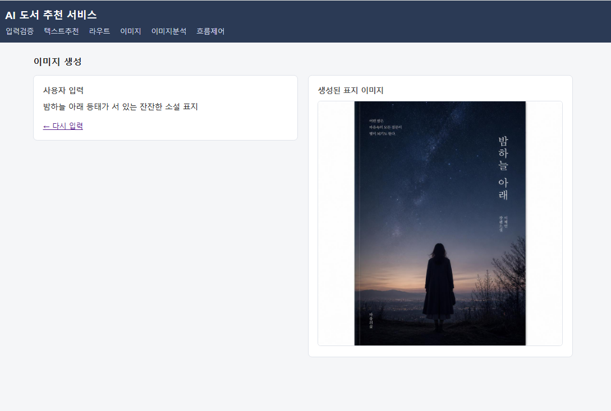
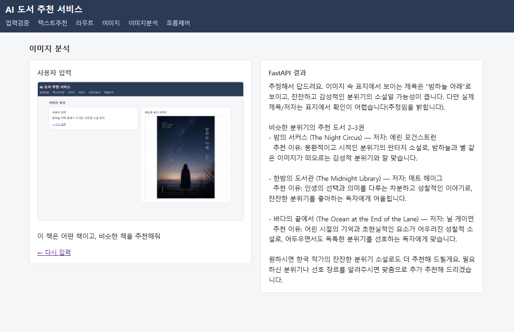
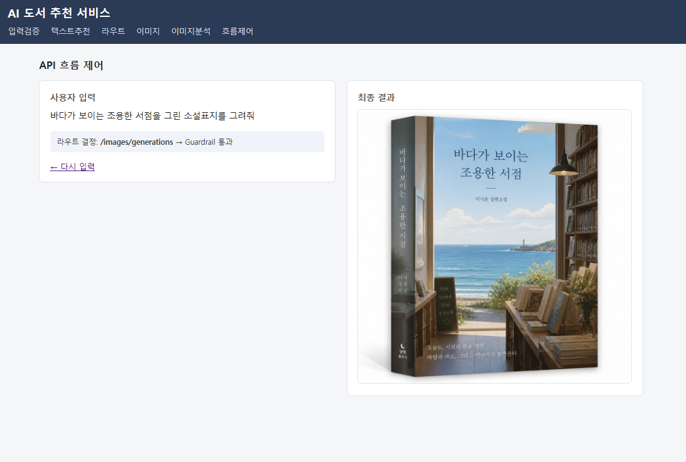

# AI 도서 추천 서비스 (07-pjt)

Django와 FastAPI를 연결하여 도서 추천, 표지 이미지 생성 및 분석 기능을 구현했다.

필수 기능 F701~F708을 팀원 A와 B가 4개씩 나누어 작업했다.

## 1. 주요 기능 및 실행 화면

### 1-1. 입력 검증 (F701)

Django ModelForm을 활용하여 사용자의 입력값을 검증하고 데이터베이스에 저장한다.

- 필수 입력 검증
- 최대 300자 제한
- 유효한 입력값 DB 저장

**입력 검증 실패**

**입력 검증 성공**

### 1-2. 텍스트 도서 추천 (F702)

사용자가 입력한 취향이나 상황에 맞는 도서 2~3권을 AI가 추천한다.

- GMS 채팅 API 호출
- 도서 제목, 저자, 추천 이유 반환
- Django 화면에 추천 결과 출력

**텍스트 추천 결과**

### 1-3. Guardrail (F703)

사용자의 요청이 적절한지 AI로 판단하고, 부적절한 요청을 차단한다.

- JSON 스키마 기반 Boolean 응답
- 적절한 요청은 정상 처리
- 부적절한 요청은 HTTP 403 반환

**부적절한 요청 차단**

### 1-4. 이미지 생성 (F705)

사용자가 입력한 설명을 기반으로 AI가 도서 표지 이미지를 생성한다.

- GMS 이미지 생성 API 호출
- 생성 결과를 base64로 반환
- Django 화면에 생성 이미지 표시

**도서 표지 이미지 생성 결과**

### 1-5. 이미지 분석 (F707)

사용자가 업로드한 책 표지 이미지와 질문을 AI에 전달하여 분석한다.

- 이미지 데이터를 base64로 변환
- 이미지와 질문을 멀티모달 메시지로 전달
- 표지 분석 및 유사 도서 추천 결과 출력

**이미지 분석 결과**

### 1-6. API 흐름 제어 (F704, F708)

사용자 요청을 분석하여 텍스트 추천 또는 이미지 생성 API로 자동 분기한다.

- 사용자 요청에 따라 API 경로 결정
- 선택된 API 호출
- Guardrail 검사 후 결과 출력
- 응답 상태에 따라 결과·거절·오류 화면 구분

**API 흐름 제어 결과**

## 2. 팀원별 구현 기능

### 고근우

- **F701 입력 검증**: 모델에 `request_text` 필드를 추가하고 ModelForm으로 필수 입력과 300자 제한을 검증했다. 입력값 저장 뷰를 작성하고 마이그레이션과 검증 테스트를 진행했다.
- **F703 Guardrail**: JSON 스키마로 요청의 적절성을 Boolean으로 반환하도록 구현했다. 생성 전에 검사하고 부적절한 요청은 403으로 거절했다.
- **F705 이미지 생성**: GMS 이미지 생성 API를 호출하고, 생성된 표지를 base64 문자열로 반환하여 화면에 표시했다.
- **F707 이미지 분석**: 책 표지 이미지와 질문을 멀티모달 메시지로 구성하여 LLM에 전달하고 분석 결과를 반환했다.

### 김석환

- **F702 텍스트 추천**: `ask_gms()`로 사용자의 취향에 맞는 도서 추천을 요청하고, 답변을 `content`로 반환했다.
- **F704 라우트 결정**: 사용자 요청을 텍스트 추천과 이미지 생성으로 분류하고, JSON 스키마로 처리할 API 경로를 반환했다.
- **F706 공통 에러 처리**: GMS 호출 실패와 연결 오류를 503으로 처리하고, Guardrail에서 발생한 403은 그대로 유지하도록 했다.
- **F708 API 흐름 제어**: Django에서 라우트를 결정한 뒤 해당 생성 API를 호출했다. 응답 코드에 따라 결과, 거절, 오류 화면을 보여주도록 구현했다.

## 3. 느낀 점

### 고근우

ModelForm으로 입력값을 검증하고 Guardrail로 요청을 검사하면서 두 검증의 역할 차이를 이해했다.

이미지 생성과 분석을 구현하며 base64와 멀티모달 메시지로 이미지 데이터를 전달하는 방법을 배웠다.

이미지 생성 오류를 확인하면서 API가 지원하는 모델과 서버 로그를 살펴보는 것이 중요하다고 느꼈다.

### 김석환

텍스트 추천과 라우트 결정을 구현하며 JSON 스키마로 응답 형식을 정하는 방법을 배웠다.

응답 코드에 따라 결과와 오류 화면을 나누면서 예외 처리의 필요성을 느꼈다.

여러 API를 하나의 흐름으로 연결하려면 팀원과 요청·응답 형식을 미리 맞추는 것이 중요하다는 것을 알게 되었다.